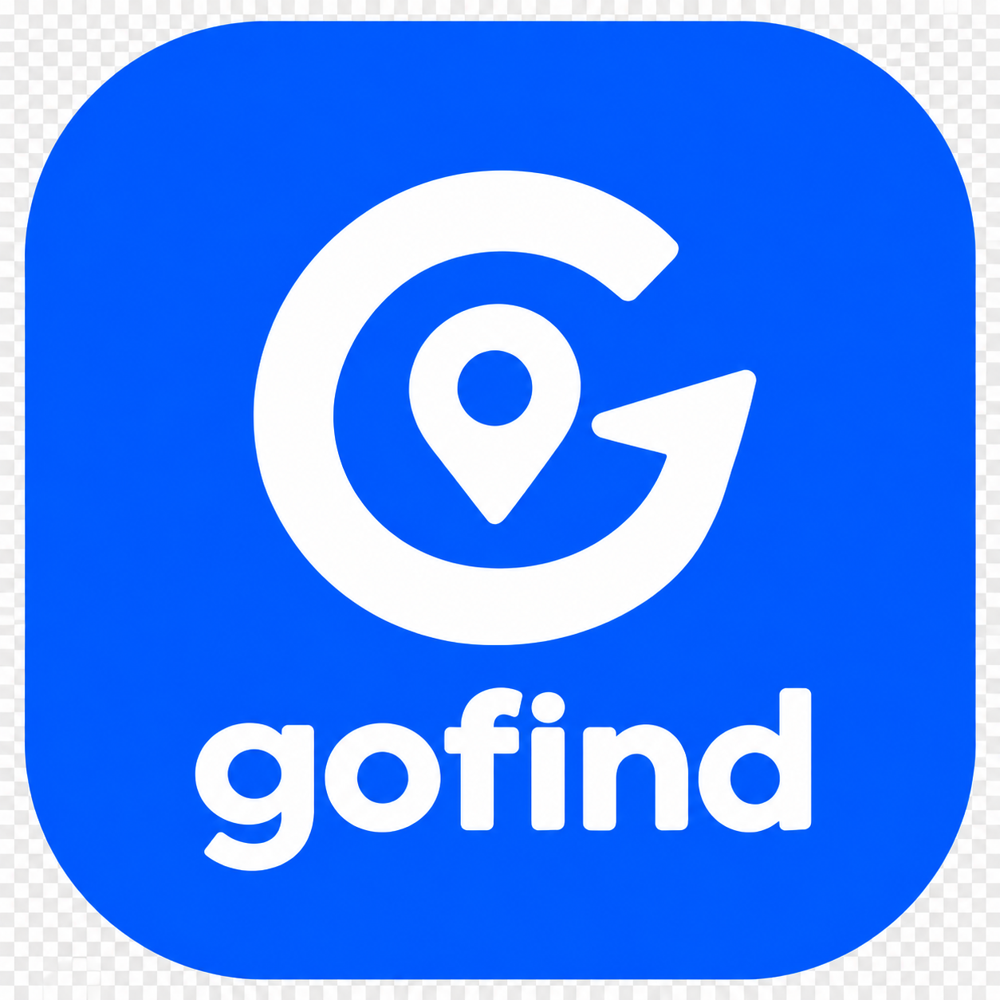

# 📍 GoFind

<div align="center">



### Encontre seus amigos mesmo sem internet.

Aplicativo acadêmico desenvolvido em **Flutter** para ajudar grupos de pessoas a se localizarem em ambientes com pouca ou nenhuma conexão com a internet, utilizando comunicação **peer-to-peer** entre dispositivos.


</div>

---

## 📖 Sobre

O **GoFind** foi criado para facilitar o encontro entre amigos e familiares em locais com grande concentração de pessoas, onde a conexão com a internet pode ficar instável, como:

- 🎵 Shows
- 🎭 Carnaval
- 🎆 Festivais
- ⚽ Estádios
- 🎡 Parques

A proposta é permitir a localização dos integrantes de um grupo utilizando comunicação local entre dispositivos, sem depender de internet.

---

## ✨ Funcionalidades

- 👤 Perfil local
- 👥 Criação de grupos
- 🔑 Entrada por código
- 📡 Comunicação offline
- 📍 Radar de proximidade
- 💬 Chat local
- 🚨 Função "Estou perdido"
- 📍 Ponto de encontro

---

## 🛠 Tecnologias

- Flutter
- Dart
- Nearby Connections API
- Bluetooth / BLE
- Wi-Fi Direct
- Hive

---

## 🚀 Executando o projeto

```bash
git clone https://github.com/JulioC3sarDev/GOFIND.git

cd GOFIND

flutter pub get

flutter run
```

---

## 🎓 Projeto acadêmico

Desenvolvido como projeto da disciplina de **Desenvolvimento Mobile**, explorando conceitos como:

- Desenvolvimento multiplataforma
- Comunicação peer-to-peer
- Persistência local
- Desenvolvimento offline-first
- UX/UI com Flutter